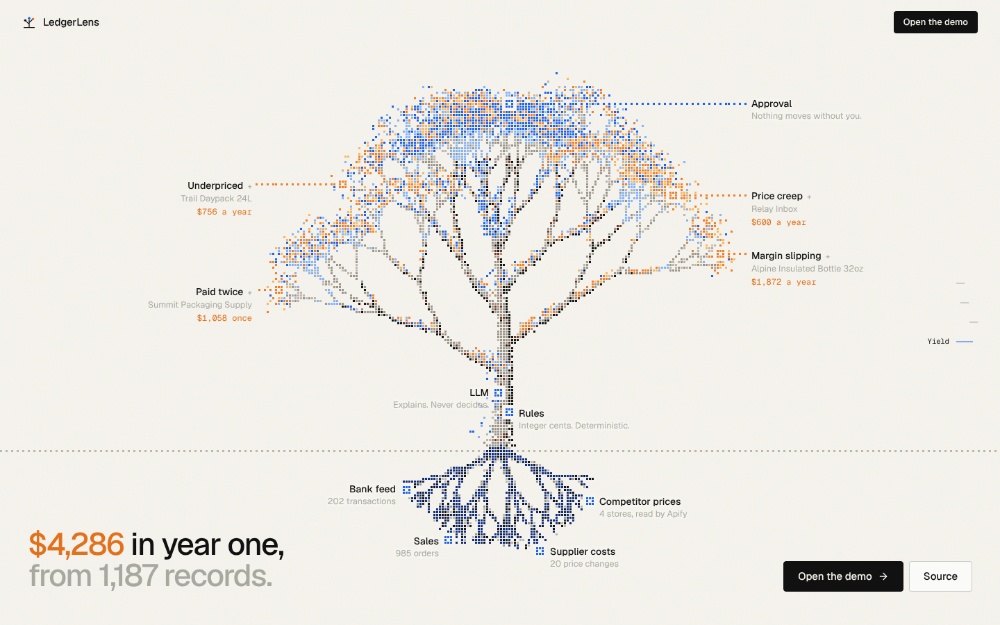
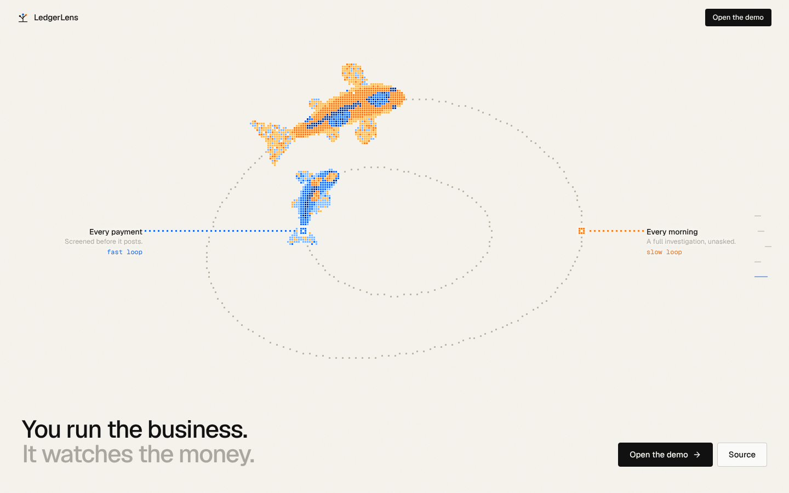
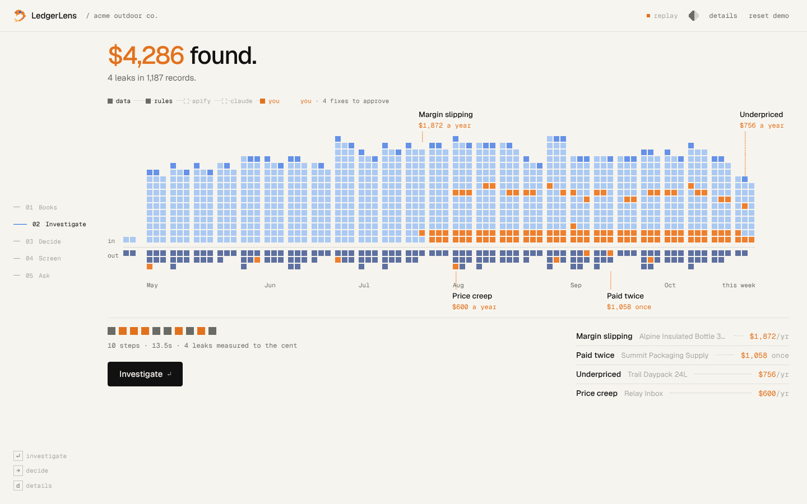
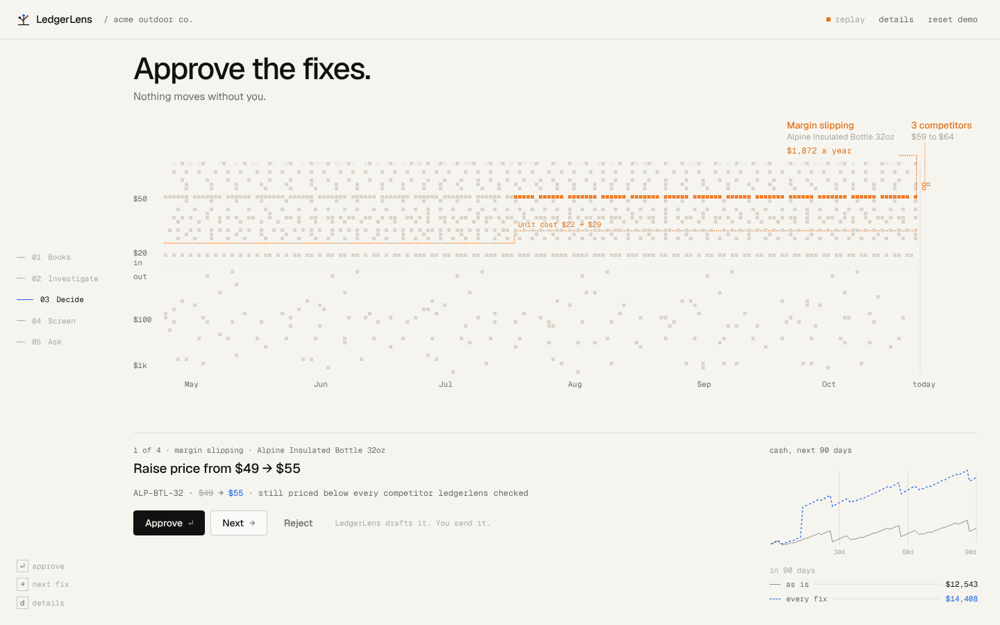
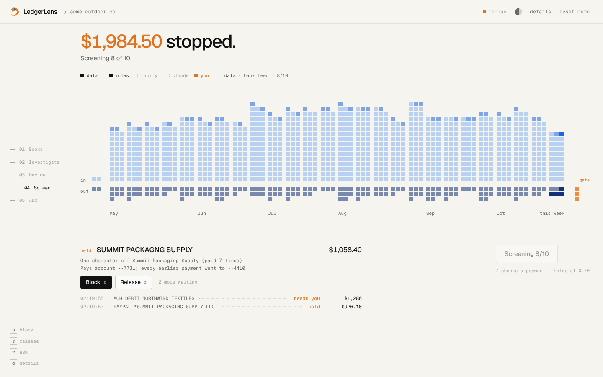
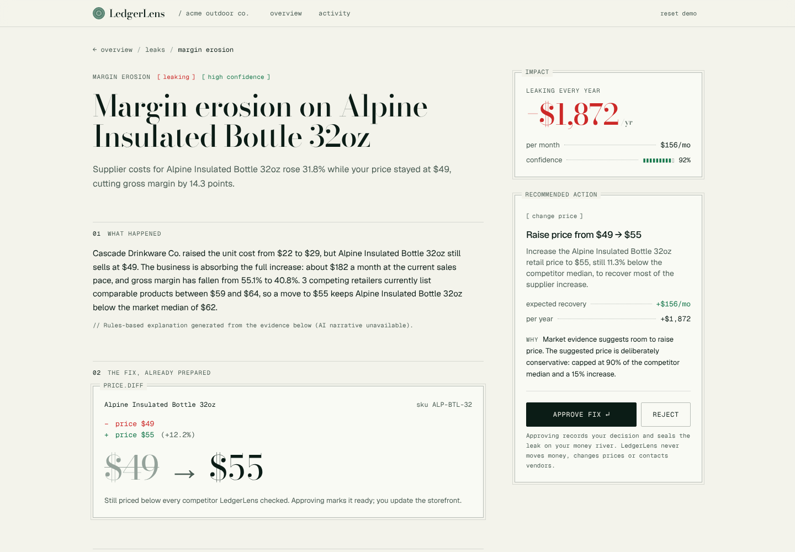
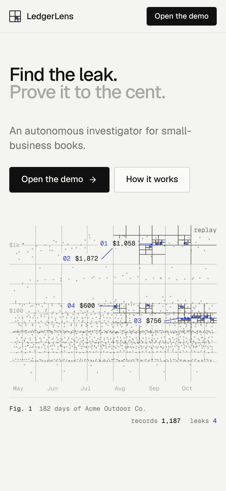

# LedgerLens

LedgerLens puts a small online business's books on one screen: every sale and every payment of the last six months is one square, placed by day and by amount, with money in above the line and money out below it. An agent then investigates the ledger, pulls competitor prices with an Apify Actor, measures each leak in exact cents, lights up the records each leak rests on, and **prepares the fix**: a refund request email, a plan review email, or a ready price change. The owner decides one fix at a time. Nothing is ever sent or changed without them, and every decision is written to an audit trail.

The 90-day cash forecast beside each decision shows cash as it is, with the fixes approved so far, and with every prepared fix, so an owner sees the size of the opportunity before deciding anything.

The seeded demo company, **Acme Outdoor Co.**, has four leaks for LedgerLens to find:

| Finding | What LedgerLens finds | Recoverable |
| --- | --- | --- |
| Duplicate payment | Summit Packaging invoice INV-20418 paid twice, 5 days apart | $1,058 one-time |
| Margin erosion | Alpine Insulated Bottle 32oz: supplier cost $22 → $29 (+31.8%), price unchanged at $49, margin 55.1% → 40.8%. Competitors list at $59 / $62 / $64; recommend $55 | $156/mo, $1,872/yr |
| Pricing opportunity | Trail Daypack 24L sells at $79; competitors list at $92 / $96 / $99; recommend $86 | $63/mo, $756/yr |
| Subscription creep | Relay Inbox went from $69 to $119 a month | $50/mo, $600/yr |
| **Total** | | **$4,286/yr, $269/mo recurring** |

These figures are computed by the engine from the seeded records on every run. They are not hardcoded in the UI, and the test suite asserts them.

### Two loops

The investigation above is the **slow loop**: it reads six months of books, gathers market evidence and writes findings. Beside it runs a **fast loop** for money as it moves:

- **Live feed.** Payments arrive from the bank feed and each one is screened inside the Convex mutation that receives it, before it posts (`lib/watch/screen.ts`). Signals: a payee name one or two keystrokes from a known payee (Damerau-Levenshtein, plus lookalike characters such as `1` for `l`), a receiving account that differs from every earlier payment, an invoice number that was already paid, a duplicate of a recent payment, an amount far above the payee's median, and a large first payment. The demo feed includes an impersonator invoicing as the packaging supplier with new bank details, a second payment of an invoice already paid, and an ad charge 3.7 times the usual.
- **Autopilot, inside limits.** The owner sets three limits: the risk score at which a payment is held, the score at which it posts but is flagged, and the amount above which even a clean payment waits for approval. Autopilot acts only inside those limits and records every action in the audit log as the agent; held and escalated payments wait for a person to release or block them.
- **Cash forecast.** Cash today and for the next 90 days (`lib/finance/forecast.ts`): fixed charges on their own cycle, everything else at its trailing 90-day rate, with approved fixes as a solid line and the rest dashed. Approving a fix moves money from one line to the other.
- **Ask your books.** Questions are answered by Claude through read-only tools that compute in code and return money already formatted (`lib/ask/tools.ts`): transaction search with exact totals, vendor history, findings, the live feed, the forecast, product economics and category spend. Each tool call appears live as a step. Answers must cite the records behind each claim; citations to records no tool returned are dropped, and every dollar figure in the answer is checked against the tool results and shown as traced or not.

## Architecture

```
  Browser                      Convex deployment
  ┌──────────────┐  live    ┌────────────────────────────────────────────────┐
  │ Overview     │◄────────►│ queries     field.get, dashboard.get,          │
  │ Finding      │ websocket│             investigations.timeline, ...       │
  │ Audit log    │          │ mutations   investigations.start,              │
  │              │          │             recommendations.approve / reject   │
  └──────▲───────┘          │                    │ scheduler.runAfter(0)     │
         │ SSR preload      │                    ▼                           │
  ┌──────┴───────┐          │ ┌──── engine.run (Node action) ──────────────┐ │
  │ Next.js app  │          │ │ CREATED → INGESTING → ANALYZING_INTERNAL_  │ │
  │ (Vercel)     │          │ │ DATA → GENERATING_HYPOTHESES → GATHERING_  │ │
  │ pages, /api, │          │ │ EXTERNAL_EVIDENCE → VALIDATING_FINDINGS →  │ │
  │ /market      │          │ │ CALCULATING_IMPACT → GENERATING_RECOMMEN-  │ │
  │ no secrets   │          │ │ DATIONS → COMPLETED   (or FAILED)          │ │
  └──────────────┘          │ └──┬───────────────┬───────────────┬─────────┘ │
                            │ ┌──▼─────────┐ ┌───▼────────┐ ┌────▼───────┐   │
                            │ │ Finance    │ │ External   │ │ AI layer   │   │
                            │ │ int cents, │ │ intel      │ │ (Claude)   │   │
                            │ │ pure TS    │ │ Apify or   │ │ Zod-checked│   │
                            │ └────────────┘ │ fixtures   │ │ narratives │   │
                            │                └───┬────────┘ └────────────┘   │
                            │ tables: 18, indexed by organization            │
                            └────────────────────┼───────────────────────────┘
                                                 ▼
                                 ┌───────────────────────────────┐
                                 │ Apify platform                │
                                 │ ledgerlens-competitor-pricing │
                                 │ CheerioCrawler → dataset      │
                                 └───────────────────────────────┘
```

Every engine step is a Convex mutation, so each timeline event, finding and approval reaches every open browser the moment it commits. The browser never polls. The Next.js app only knows the deployment's public URL; the Anthropic and Apify keys live in the Convex deployment environment.

| Path | Responsibility |
| --- | --- |
| `lib/finance/` | Money math in integer cents, duplicate detection, recurring-expense detection, margin analysis, pricing recommendations, impact aggregation. Pure functions with no I/O. |
| `convex/` | Schema, queries, mutations, the engine action and demo reset. `convex/_generated` is checked in; `npx convex dev` keeps it current. |
| `lib/investigation/` | State machine, step events, the storage-agnostic engine (`InvestigationStore`), carry-forward of earlier decisions, and execution checklists. |
| `lib/apify/` | Apify client (start, poll, fetch dataset), Zod validation of Actor output, normalization, and the labeled fixture fallback. |
| `lib/ai/` | Provider interface, Anthropic provider, deterministic provider, prompts, schemas and grounding checks. |
| `lib/views/` | Pure builders for the dashboard and finding detail shapes, shared by Convex queries and the UI. |
| `lib/field/` | The overview's field: every record with its day and amount, and the records, cost change and competitor prices each finding rests on. `convex/field.ts` serves it live; the offline preview builds the same shape. |
| `components/overview/` | The overview: five beats (books, investigate, decide, screen, ask) over one canvas field, fed by live Convex subscriptions or by an offline replay of the engine. |
| `lib/river/` | Spending streams (product costs, shipping, team, marketing, software, overhead) used by the dashboard query and to tag findings. |
| `lib/investigation/drafts.ts` | Builds the prepared fix for each finding (emails and price changes) from deterministic finding data only. |
| `lib/watch/` | The payment screen and the demo bank feed. `convex/watch.ts` runs it on each arriving payment and applies the autopilot policy. |
| `lib/ask/` | Books tools, answer grounding and the vendor-neutral agent loop. `convex/ask.ts` stores questions; `convex/agent.ts` runs Claude's tool loop. |
| `lib/finance/forecast.ts` | The 90-day cash forecast. |
| `lib/demo/` | Demo catalog and the seeded generator for 182 days of records. |
| `apify/ledgerlens-competitor-pricing/` | The Apify Actor. |
| `app/market/[competitor]/[product]` | Sandbox competitor storefront pages with schema.org JSON-LD. The seeded competitor listings point here, so live mode exercises a real Apify crawl without scraping third-party shops. The prices on these pages are set by the demo, so results from them are labeled "Demo storefront" and never presented as market data. |

## Why deterministic finance plus AI

Money is never calculated by a language model. Every amount is an integer number of cents produced by the finance engine, with explicit rounding rules, and covered by unit tests. The model only does what it is good at: deciding which products are worth researching and writing a plain-English explanation of evidence it was given.

The AI output is constrained:

- Responses are parsed against a strict Zod schema; invalid output is retried once and then replaced by the deterministic narrative.
- The recommended action type must be one the finding allows, and the stored action type always comes from the deterministic proposal.
- Every dollar figure in the model's text must match an amount in the evidence (within $1). A narrative that mentions an invented amount is rejected.
- Model confidence can move the deterministic confidence down by at most 0.15 or up by at most 0.05.
- When no API key is configured, or the call fails or times out, LedgerLens uses rules-based narratives and labels them as such in the UI.

## How Apify is used

During `GATHERING_EXTERNAL_EVIDENCE`, LedgerLens selects products with margin erosion or a pricing gap, builds an input of competitor product URLs, and runs the `ledgerlens-competitor-pricing` Actor:

1. Every URL passes an SSRF guard in the app (`lib/utils/url-safety.ts`) before it is sent, and again inside the Actor with a DNS check, including after redirects.
2. The app starts the run with `apify-client`, polls until it finishes or `APIFY_TIMEOUT_MS` passes (then aborts the run), and reads the dataset.
3. Each record is validated with Zod and normalized to cents. Records without a trustworthy price are dropped; the Actor writes them to a `FAILURES` key-value record instead of guessing.
4. Observations are stored with source URL, capture time, Apify run ID, raw payload and `capture_mode = live`.

The Actor extracts prices from JSON-LD, then meta tags, then microdata, then common selectors.

If the token is missing, the run fails, times out, or returns no usable prices, LedgerLens falls back to the fixture dataset, records a warning on the investigation, and labels the evidence "Demo dataset, not live market data". It never presents fixture data as live.

The seeded listings point at LedgerLens's own sandbox storefront pages. A live run against them is a real crawl, but the prices on those pages are set by the demo, so the UI labels that evidence "Demo storefront" and the investigation records `sandbox: true`. Only evidence from pages other than these sandbox pages is labeled "Live". To collect real market prices, replace the URLs in the `competitorProducts` table with public product pages from real retailers.

## Setup

Requirements: Node.js 20 or newer and a free Convex account.

```bash
npm install
npx convex dev                 # log in, create a deployment; writes .env.local and keeps running
```

In a second terminal, set the server-side keys on the Convex deployment. Each command prompts for the value, so keys never go into a file, the repository or your shell history:

```bash
npx convex env set DEMO_MODE true
npx convex env set LLM_API_KEY             # optional: Anthropic key for AI narratives
npx convex env set APIFY_TOKEN             # optional: live competitor pricing
npx convex env set APIFY_ACTOR_ID          # e.g. your-username/ledgerlens-competitor-pricing
npx convex env set EXTERNAL_INTEL_MODE live
npm run demo:seed
npm run dev                    # http://localhost:3000 (the app at /overview)
```

You can also enter them in the Convex dashboard under Settings → Environment Variables.

## Environment variables

See `.env.example` for the full annotated list.

**Next.js app** (`.env.local`, written by `npx convex dev`; on Vercel, set by `npx convex deploy`):

| Variable | Notes |
| --- | --- |
| `NEXT_PUBLIC_CONVEX_URL` | Address of the Convex deployment. Public by design. |
| `CONVEX_DEPLOYMENT` | Used by the Convex CLI in development. |
| `CONVEX_DEPLOY_KEY` | Vercel only, for `npx convex deploy` during the build. Secret. |

**Convex deployment** (`npx convex env set NAME`):

| Variable | Required | Notes |
| --- | --- | --- |
| `APP_URL` | yes in production | Public URL of the Next.js app. Seeded competitor listings point at `<url>/market/...`. |
| `LLM_PROVIDER` | no | `anthropic` (default) or `none`. |
| `LLM_API_KEY` | no | Anthropic API key. Without it, narratives are rules-based. |
| `LLM_MODEL` | no | Default `claude-opus-5-5`. |
| `APIFY_TOKEN` | no | Needed for live market data. |
| `APIFY_ACTOR_ID` | no | e.g. `your-username/ledgerlens-competitor-pricing`. |
| `EXTERNAL_INTEL_MODE` | no | `fixture` (default) or `live`. |
| `DEMO_MODE` | no | `true` enables Load demo and Reset demo. |
| `INVESTIGATION_STEP_DELAY_MS` | no | Pause between steps so the timeline is readable. Default 450. |

The secret keys exist only inside Convex functions. `npm run check:bundle` scans the built client bundle for secret names and key-shaped strings and fails if it finds any.

## Demo seed

```bash
npm run demo:seed     # convex run engine:seedDemo: creates Acme Outdoor Co. if missing
npm run demo:reset    # convex run engine:resetDemo: deletes and recreates it, plus a baseline investigation
```

The seed is deterministic (a fixed-seed PRNG) and anchored to the current date, so the 182 days of sales, transactions and supplier costs always end today. It creates 18 products, 985 sales lines, 202 transactions, 20 supplier cost records, 4 competitors and 8 competitor listings.

The **Reset demo** button in the header (demo mode only) does the same thing as `demo:reset`: it removes investigations, findings, evidence, recommendations, audit entries and price observations, restores the seeded records and fixture competitor data, and returns the dashboard to its starting state.

## Local development

```bash
npx convex dev        # terminal 1: pushes functions on save
npm run dev           # terminal 2
```

After adding or removing a file in `convex/` without the CLI running, `npm run convex:codegen` refreshes `convex/_generated` offline. A fixture-mode investigation takes about 5 seconds with the default step delay. To exercise the Actor locally against the sandbox storefront:

```bash
cd apify/ledgerlens-competitor-pricing
npm install
mkdir -p storage/key_value_stores/default
echo '{"products":[{"internalProductId":"p1","competitor":"Ridgeline Supply Co.","url":"http://localhost:3000/market/ridgeline-supply/alpine-insulated-bottle"}]}' \
  > storage/key_value_stores/default/INPUT.json
LEDGERLENS_ALLOW_PRIVATE_HOSTS=true node src/main.js
```

`LEDGERLENS_ALLOW_PRIVATE_HOSTS` only permits `localhost` and `127.0.0.1`, and is ignored when the Actor runs on the Apify platform.

## Running tests

```bash
npm run test         # Vitest: finance, Apify, AI validation, full investigation
npm run typecheck
npm run lint
npm run verify       # typecheck, lint, test, build, check:bundle
```

The investigation tests run the real Convex schema, queries, mutations and engine against `convex-test`'s in-memory backend, so they need no deployment or network. They seed the demo company, run complete investigations in fixture mode, and assert the exact finding values above, approval and rejection, decisions carrying forward to the next run, and fallbacks when Apify or the model fail.

## Deploying

**1. Apify Actor.**

```bash
npm install -g apify-cli
apify login
cd apify/ledgerlens-competitor-pricing
apify push
```

Set `APIFY_ACTOR_ID` to `<username>/ledgerlens-competitor-pricing` and `APIFY_TOKEN` to an API token, on the production Convex deployment (`npx convex env set --prod ...`), along with `APP_URL=https://your-app.vercel.app` and `DEMO_MODE=true`.

**2. App (Vercel).** In the Convex dashboard, generate a production deploy key. Import the repository in Vercel, add `CONVEX_DEPLOY_KEY`, and set the build command to:

```bash
npx convex deploy --cmd 'npm run build'
```

That pushes the Convex functions and builds Next.js against the production deployment's URL. Then run `npx convex run --prod engine:seedDemo` (or click Load demo) so the seeded competitor URLs use the deployed `APP_URL`.

## Demo mode

With `DEMO_MODE=true` (on the Convex deployment) the header shows **Reset demo** and the demo seed and reset functions run. With it off, they refuse with FORBIDDEN and the button is hidden. The suggested demo:

1. Open the landing page and scroll: the tree grows from Acme Outdoor Co.'s books to its findings. Click a finding to grow twigs out to its evidence. Keep scrolling: the tree condenses into a drop that falls into still water, and two koi come up to swim the two loops described below. Then click **Open the demo**.
2. **Books.** The overview fills in with every record of the last six months, one square each. Press → to move between beats (or click them on the left); ↵ always does the beat's one thing.
3. **Investigate.** Press ↵. A scan line sweeps the books as the engine works through its ten steps, records it suspects turn pale orange, and each leak lights up in orange as it is measured, with its label and amount.
4. **Decide.** One fix at a time. The field zooms to the records behind it (the bottle's sales under the supplier's cost step, the two identical Summit payments, the daypack's price against three competitors, the Relay Inbox charges), with the drafted email or price change below. Press ↵ to approve: the records turn blue and the forecast picks up the fix. → moves to the next fix.
5. **Screen.** Press ↵ to start the bank feed. Ten payments arrive over about half a minute, each screened before it posts. The lookalike supplier, the invoice that was already paid and the payment above the approval limit stop past today's column. Press b to block or r to release.
6. **Ask.** Click a suggestion, or press / and type. The answer cites its records, and the field pins each one.
7. Press d at any time for the engine's step timings, the inputs, the audit trail and the live subscriptions. **Reset demo** starts over.

To record the walkthrough in one take, press p (or open `/overview?tour`): the overview plays every beat by itself, waiting on the engine, the feed and the agent rather than on a timer, and approves two fixes, blocks the lookalike payment and asks one question along the way. Any key hands control back.

## Limitations

- Margin and pricing findings annualize the trailing 90 days of unit sales (multiplied by 4). Seasonal businesses will see different figures at different times of year.
- Single organization per deployment; there is no authentication or multi-tenant access control. Do not put real financial data in a public demo deployment.
- Data comes from the seed. There are no bank, Shopify or accounting integrations yet.
- LedgerLens does not execute financial actions. Approval produces a checklist and marks the recommendation Ready for execution.
- Pricing recommendations assume unit sales hold at the new price; price elasticity is not modelled, and each finding says so in its uncertainty section.
- Investigations run as a Convex action, which has a 10-minute limit. A run that outlives it is marked FAILED on the next start and previous findings stay visible.
- The seeded listings target the bundled sandbox storefront pages, so a live run demonstrates the crawl rather than real market prices. Pointing listings at real retailers needs comparable products chosen by hand and a check of each site's terms of service.

## Safety

- **Secrets stay on the server.** `LLM_API_KEY` and `APIFY_TOKEN` are set on the Convex deployment and read only inside Convex functions; the Next.js app never sees them. `npm run check:bundle` verifies the client bundle.
- **SSRF protection.** URLs sent to the Actor must be http(s) on a public host. Localhost, private, link-local, CGNAT and metadata addresses are rejected in the app and again in the Actor after DNS resolution and after redirects.
- **Validated inputs and outputs.** API bodies, Convex function arguments, Apify records and model responses are all validated with Zod. API errors use one envelope: `{ "error": { "code", "message" } }`.
- **Human in the loop.** Recommendations stay PROPOSED until a person approves or rejects them. Each decision is written to the `auditLog` table in the same transaction.
- **Logs are redacted.** The structured JSON logger replaces any field whose name looks like a token, secret, key, password, cookie or authorization header with `[redacted]`.

## Screenshots

The landing page, fully grown. The roots are the demo company's books, the trunk is the engine, each limb is a finding, and the share of a limb that is orange is proportional to the money it recovers. Scrolling grows the tree; clicking a finding grows twigs out to its evidence. Past the tree, the blue koi swims the fast loop (each payment screened before it posts) and the orange one the slow loop (an investigation every morning):





The overview after an investigation: 1,187 records, four leaks lit up in orange, each label pointing at the record it was measured from:



Deciding a fix: the field zooms to the bottle's sales lane, the supplier's cost step from $22 to $29 and three competitor prices, with the price change drafted below:



Screening the bank feed: the lookalike supplier, an invoice already paid and a payment above the approval limit stop before they post:



A leak with its fix already prepared, plus the evidence behind it:



On a phone:



The look is a field notebook: warm paper, black ink, hairline rules, and two pigments. Blue is the books; orange is money the engine found. Type is Geist, with anything measured set in Geist Mono. The landing tree is generated from a fixed seed (`lib/landing/tree.ts`) and drawn on a pixel grid on a canvas, one frame per scroll position; the drop, ripples and koi that follow it (`lib/landing/pond.ts`) are drawn on the same grid. The overview's field is drawn on a canvas too: each square eases to its color on its own clock, so a finding spreads through its records from the one its label points at, and the amount scale glides when a fix is brought into focus. Every figure on the landing page comes from running the engine over the demo books at build time (`lib/landing/data.ts`). The site follows the system light or dark setting and respects reduced motion.

In development, `/preview/overview`, `/preview/findings/0` and `/preview/activity` render the app views from an in-memory engine run, without a Convex deployment (`?approved=1` on a finding shows the approved state). These routes return 404 in production.
