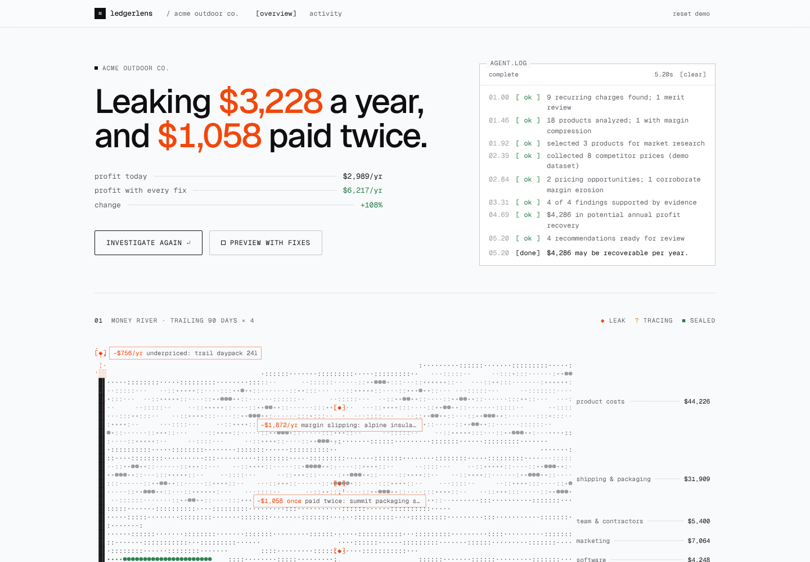
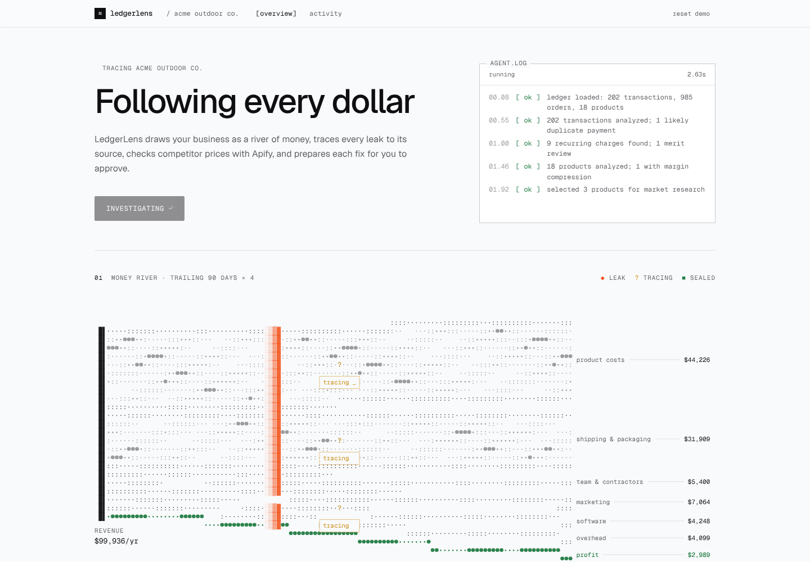

# LedgerLens

LedgerLens shows a small online business its **money river**: every dollar of revenue flowing out to product costs, shipping, team, marketing, software, overhead and, finally, profit. An agent then investigates the ledger, finds where money is leaking out of that river, pulls competitor prices with an Apify Actor, measures each leak in exact cents, and **prepares the fix**: a refund request email, a plan review email, or a ready price change. When the owner approves a fix, the leak seals and the profit stream visibly widens. Nothing is ever sent or changed without the owner, and every decision is written to an audit trail.

"Preview with fixes" redraws the river as if every prepared fix were approved, so an owner sees the size of the opportunity before deciding anything.

The seeded demo company, **Acme Outdoor Co.**, has four leaks for LedgerLens to find:

| Finding | What LedgerLens finds | Recoverable |
| --- | --- | --- |
| Duplicate payment | Summit Packaging invoice INV-20418 paid twice, 5 days apart | $1,058 one-time |
| Margin erosion | Alpine Insulated Bottle 32oz: supplier cost $22 → $29 (+31.8%), price unchanged at $49, margin 55.1% → 40.8%. Competitors list at $59 / $62 / $64; recommend $55 | $156/mo, $1,872/yr |
| Pricing opportunity | Trail Daypack 24L sells at $79; competitors list at $92 / $96 / $99; recommend $86 | $63/mo, $756/yr |
| Subscription creep | Relay Inbox went from $69 to $119 a month | $50/mo, $600/yr |
| **Total** | | **$4,286/yr, $269/mo recurring** |

These figures are computed by the engine from the seeded records on every run. They are not hardcoded in the UI, and the test suite asserts them.

## Architecture

```
                        ┌──────────────────────────────────────────────┐
  Browser               │  Next.js App Router (Vercel)                 │
  ┌────────────┐  poll  │                                              │
  │ Dashboard  │◄──────►│  /api/investigations  ──► after() ──┐        │
  │ Timeline   │  1s    │  /api/findings, /api/recommendations │        │
  │ Finding    │        │  /api/audit, /api/demo/*             │        │
  └────────────┘        │                                      ▼        │
                        │  ┌─────────────── Investigation engine ─────┐ │
                        │  │ state machine: CREATED → INGESTING →     │ │
                        │  │ ANALYZING_INTERNAL_DATA → GENERATING_    │ │
                        │  │ HYPOTHESES → GATHERING_EXTERNAL_EVIDENCE │ │
                        │  │ → VALIDATING_FINDINGS → CALCULATING_     │ │
                        │  │ IMPACT → GENERATING_RECOMMENDATIONS →    │ │
                        │  │ COMPLETED   (or FAILED)                  │ │
                        │  └───┬──────────────┬──────────────┬────────┘ │
                        │      │              │              │          │
                        │  ┌───▼────────┐ ┌───▼────────┐ ┌───▼────────┐ │
                        │  │ Finance    │ │ External   │ │ AI layer   │ │
                        │  │ engine     │ │ intel      │ │ (Claude)   │ │
                        │  │ int cents, │ │ Apify or   │ │ Zod-checked│ │
                        │  │ pure TS    │ │ fixtures   │ │ narratives │ │
                        │  └────────────┘ └───┬────────┘ └────────────┘ │
                        └─────────┬───────────┼────────────────────────┘
                                  │           │
                    ┌─────────────▼──┐   ┌────▼──────────────────────────┐
                    │ Supabase       │   │ Apify platform                │
                    │ Postgres       │   │ ledgerlens-competitor-pricing │
                    │ (Drizzle ORM)  │   │ CheerioCrawler → dataset      │
                    └────────────────┘   └───────────────────────────────┘
```

| Path | Responsibility |
| --- | --- |
| `lib/finance/` | Money math in integer cents, duplicate detection, recurring-expense detection, margin analysis, pricing recommendations, impact aggregation. Pure functions with no I/O. |
| `lib/investigation/` | State machine, step events, evidence and finding persistence, the engine that runs an investigation, and approve/reject actions. |
| `lib/apify/` | Apify client (start, poll, fetch dataset), Zod validation of Actor output, normalization, and the labeled fixture fallback. |
| `lib/ai/` | Provider interface, Anthropic provider, deterministic provider, prompts, schemas and grounding checks. |
| `lib/db/` | Drizzle schema (15 tables), client and read queries. |
| `lib/river/` | Stream definitions shared by the server query that measures the river and the animated SVG that draws it. |
| `lib/investigation/drafts.ts` | Builds the prepared fix for each finding (emails and price changes) from deterministic finding data only. |
| `lib/demo/` | Demo catalog, seeded generator for 182 days of records, reset service. |
| `apify/ledgerlens-competitor-pricing/` | The Apify Actor. |
| `app/market/[competitor]/[product]` | Sandbox competitor storefront pages with schema.org JSON-LD. The seeded competitor listings point here, so live mode exercises a real Apify crawl without scraping third-party shops. The prices on these pages are set by the demo, so results from them are labeled "Demo storefront" and never presented as market data. |

## Why deterministic finance plus AI

Money is never calculated by a language model. Every amount is an integer number of cents produced by the finance engine, with explicit rounding rules, and covered by unit tests. The model only does what it is good at: deciding which products are worth researching and writing a plain-English explanation of evidence it was given.

The AI output is constrained:

- Responses are parsed against a strict Zod schema; invalid output is retried once and then replaced by the deterministic narrative.
- The recommended action type must be one the finding allows, and the stored action type always comes from the deterministic proposal.
- Every dollar figure in the model's text must match an amount in the evidence (within $1). A narrative that mentions an invented amount is rejected.
- Model confidence can move the deterministic confidence down by at most 0.15 or up by at most 0.05.
- When no API key is configured, or the call fails or times out, LedgerLens uses rules-based narratives and labels them as such in the UI.

## How Apify is used

During `GATHERING_EXTERNAL_EVIDENCE`, LedgerLens selects products with margin erosion or a pricing gap, builds an input of competitor product URLs, and runs the `ledgerlens-competitor-pricing` Actor:

1. Every URL passes an SSRF guard in the app (`lib/utils/url-safety.ts`) before it is sent, and again inside the Actor with a DNS check, including after redirects.
2. The app starts the run with `apify-client`, polls until it finishes or `APIFY_TIMEOUT_MS` passes (then aborts the run), and reads the dataset.
3. Each record is validated with Zod and normalized to cents. Records without a trustworthy price are dropped; the Actor writes them to a `FAILURES` key-value record instead of guessing.
4. Observations are stored with source URL, capture time, Apify run ID, raw payload and `capture_mode = live`.

The Actor extracts prices from JSON-LD, then meta tags, then microdata, then common selectors.

If the token is missing, the run fails, times out, or returns no usable prices, LedgerLens falls back to the fixture dataset, records a warning on the investigation, and labels the evidence "Demo dataset, not live market data". It never presents fixture data as live.

The seeded listings point at LedgerLens's own sandbox storefront pages. A live run against them is a real crawl, but the prices on those pages are set by the demo, so the UI labels that evidence "Demo storefront" and the investigation records `sandbox: true`. Only evidence from pages other than these sandbox pages is labeled "Live". To collect real market prices, replace the URLs in the `competitor_products` table with public product pages from real retailers.

## Setup

Requirements: Node.js 20 or newer, and a Postgres database (Supabase in production, any local Postgres for development).

```bash
npm install
cp .env.example .env.local     # then edit DATABASE_URL at minimum
npm run db:migrate
npm run demo:seed
npm run dev                    # http://localhost:3000
```

## Environment variables

See `.env.example` for the full annotated list.

| Variable | Required | Notes |
| --- | --- | --- |
| `DATABASE_URL` | yes | Postgres connection string. Server-only. |
| `NEXT_PUBLIC_APP_URL` | yes in production | Public URL. Seeded competitor listings point at `<url>/market/...`. |
| `LLM_PROVIDER` | no | `anthropic` (default) or `none`. |
| `LLM_API_KEY` | no | Anthropic API key. Server-only. Without it, narratives are rules-based. |
| `LLM_MODEL` | no | Default `claude-opus-5-5`. |
| `APIFY_TOKEN` | no | Server-only. Needed for live market data. |
| `APIFY_ACTOR_ID` | no | e.g. `your-username/ledgerlens-competitor-pricing`. |
| `EXTERNAL_INTEL_MODE` | no | `fixture` (default) or `live`. |
| `DEMO_MODE` | no | `true` shows Reset demo and enables `/api/demo/*`. |
| `INVESTIGATION_STEP_DELAY_MS` | no | Pause between steps so the timeline is readable. Default 450. |
| `NEXT_PUBLIC_SUPABASE_URL`, `NEXT_PUBLIC_SUPABASE_ANON_KEY`, `SUPABASE_SERVICE_ROLE_KEY` | no | Listed for completeness. The app connects to Postgres through `DATABASE_URL` on the server and does not currently read these. |

Only `NEXT_PUBLIC_*` variables can reach the browser. `npm run check:bundle` scans the built client bundle for secret names and values and fails if it finds any.

## Database migration

The schema lives in `lib/db/schema.ts`; SQL migrations are generated into `drizzle/`.

```bash
npm run db:generate   # after changing the schema
npm run db:migrate    # applies drizzle/*.sql to DATABASE_URL
```

## Demo seed

```bash
npm run demo:seed     # creates Acme Outdoor Co. if missing
npm run demo:reset    # deletes and recreates it, plus a baseline investigation
```

The seed is deterministic (a fixed-seed PRNG) and anchored to the current date, so the 182 days of sales, transactions and supplier costs always end today. It creates 18 products, 985 sales lines, 202 transactions, 20 supplier cost records, 4 competitors and 8 competitor listings.

The **Reset demo** button in the header (demo mode only) does the same thing as `demo:reset`: it removes investigations, findings, evidence, recommendations, audit entries and price observations, restores the seeded records and fixture competitor data, and returns the dashboard to its starting state.

## Local development

```bash
npm run dev
```

A fixture-mode investigation takes about 5 seconds with the default step delay. To exercise the Actor locally against the sandbox storefront:

```bash
cd apify/ledgerlens-competitor-pricing
npm install
mkdir -p storage/key_value_stores/default
echo '{"products":[{"internalProductId":"p1","competitor":"Ridgeline Supply Co.","url":"http://localhost:3000/market/ridgeline-supply/alpine-insulated-bottle"}]}' \
  > storage/key_value_stores/default/INPUT.json
LEDGERLENS_ALLOW_PRIVATE_HOSTS=true node src/main.js
```

`LEDGERLENS_ALLOW_PRIVATE_HOSTS` only permits `localhost` and `127.0.0.1`, and is ignored when the Actor runs on the Apify platform.

## Running tests

```bash
npm run test         # Vitest: finance, Apify, AI validation, full investigation
npm run typecheck
npm run lint
npm run verify       # typecheck, lint, test, build, check:bundle
```

The investigation tests run against a real Postgres database named in `.env.test` (`ledgerlens_test` by default). They seed the demo company, run complete investigations in fixture mode, and assert the exact finding values above, approval and rejection, decisions carrying forward to the next run, and fallbacks when Apify or the model fail.

## Deploying

**1. Database (Supabase).** Create a project, copy the pooled connection string (Transaction mode, port 6543), and run:

```bash
DATABASE_URL="postgresql://..." npm run db:migrate
DATABASE_URL="postgresql://..." NEXT_PUBLIC_APP_URL="https://your-app.vercel.app" npm run demo:seed
```

**2. Apify Actor.**

```bash
npm install -g apify-cli
apify login
cd apify/ledgerlens-competitor-pricing
apify push
```

Set `APIFY_ACTOR_ID` to `<username>/ledgerlens-competitor-pricing` and `APIFY_TOKEN` to an API token.

**3. App (Vercel).** Import the project, set the environment variables from `.env.example` (`DATABASE_URL`, `NEXT_PUBLIC_APP_URL`, and optionally `LLM_API_KEY`, `APIFY_TOKEN`, `APIFY_ACTOR_ID`, `EXTERNAL_INTEL_MODE=live`), and deploy. Investigations run in the background with `after()` inside the `POST /api/investigations` function, which sets `maxDuration = 300`; check that your Vercel plan allows that duration. After the first deploy, run Reset demo once so the seeded competitor URLs use the deployed `NEXT_PUBLIC_APP_URL`.

## Demo mode

With `DEMO_MODE=true` the header shows **Reset demo** and `/api/demo/reset` and `/api/demo/seed` are enabled. With it off, those routes return 403 and the button is hidden. The suggested demo:

1. Open the dashboard: the money river shows where Acme Outdoor Co.'s revenue goes and how thin its profit is.
2. Click **Investigate again** (or **Run investigation** on a fresh seed). Suspected leaks appear on the river as the agent works, then turn into measured amounts.
3. Click **Preview with fixes** to see profit with every prepared fix approved.
4. Open the highest-value leak: review the prepared fix, the calculations and the source evidence.
5. Click **Approve fix**. The leak seals, the audit trail records the approval, and the profit stream widens on the dashboard.
6. Click **Reset demo** to start over.

## Limitations

- The money river shows the trailing 90 days multiplied by 4, the same annualization the findings use. Seasonal businesses will see a different picture at different times of year.
- Single organization per deployment; there is no authentication or multi-tenant access control. Do not put real financial data in a public demo deployment.
- Data comes from the seed. There are no bank, Shopify or accounting integrations yet.
- LedgerLens does not execute financial actions. Approval produces a checklist and marks the recommendation Ready for execution.
- Pricing recommendations assume unit sales hold at the new price; price elasticity is not modelled, and each finding says so in its uncertainty section.
- Investigations run inside a serverless function. A run that outlives the function is marked FAILED after 10 minutes and previous findings stay visible.
- The seeded listings target the bundled sandbox storefront pages, so a live run demonstrates the crawl rather than real market prices. Pointing listings at real retailers needs comparable products chosen by hand and a check of each site's terms of service.

## Safety

- **Secrets stay on the server.** `DATABASE_URL`, `LLM_API_KEY`, `APIFY_TOKEN` and `SUPABASE_SERVICE_ROLE_KEY` are read only in `server-only` modules; `npm run check:bundle` verifies the client bundle.
- **SSRF protection.** URLs sent to the Actor must be http(s) on a public host. Localhost, private, link-local, CGNAT and metadata addresses are rejected in the app and again in the Actor after DNS resolution and after redirects.
- **Validated inputs and outputs.** API bodies, Apify records and model responses are all validated with Zod. API errors use one envelope: `{ "error": { "code", "message" } }`.
- **Human in the loop.** Recommendations stay PROPOSED until a person approves or rejects them. Each decision is written to `audit_logs`.
- **Logs are redacted.** The structured JSON logger replaces any field whose name looks like a token, secret, key, password, cookie or authorization header with `[redacted]`.

## Screenshots

The money river after an investigation, with each leak marked where it drains:



The same river with every prepared fix approved:


The agent investigating, with suspected leaks marked on the river as it works:



A leak with its fix already prepared, plus the evidence behind it:


On a phone, the river's stream labels move under it:


The interface is styled as an instrument rather than a landing page: paper and ink with hairline rules, Geist Mono for anything measured, one signal orange reserved for money that is leaking, and the money river drawn as animated ASCII on a canvas. It follows the system light or dark setting and respects reduced motion.
